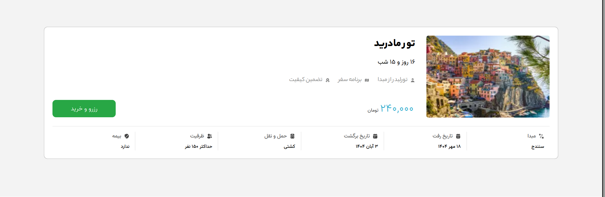

# Torino | Online Tour and Hotel Booking App

Torino is a tour and hotel booking website where users can explore, book, and manage tours. This project was developed during the Bootostart bootcamp using modern technologies.

## preview

### Tour search


### Tour details



## Technologies and tools

| Area | Tools |
| --- | --- |
| Framework | Next.js App Router, React |
| Language and styling | JavaScript, CSS Modules |
| State and data fetching | Redux Toolkit, TanStack Query, Axios |
| Forms and validation | React Hook Form, Yup |
| Interface | Swiper, Sonner, React Loading Skeleton |
| Code quality | ESLint |
| Backend | Node.js, Express, JWT |

## 📁 Project structure

```text
frontend/
├── public/              # Static images and fonts
├── src/
│   ├── app/             # Pages, routes, and layouts
│   ├── components/      # Shared UI and feature components
│   ├── hooks/           # Data-fetching and mutation hooks
│   ├── lib/             # Axios client configuration
│   ├── services/        # API requests
│   ├── store/           # Redux authentication state
│   ├── utils/           # Formatting and shared helpers
│   ├── validations/     # Form validation schemas
│   └── proxy.js         # Session checks for protected routes
└── next.config.mjs      # Next.js configuration
```

## Installation and setup

Install Node.js 20.9 or newer and npm before starting.

### 1. Clone the project

```sh
git clone https://github.com/aliPourahmady/torino-project.git
cd torino-project
```

### 2. Run the backend

```sh
cd travel-agency-api
npm install
npm start
```

### 3. Configure the frontend

Create a file named `.env.local` inside `frontend/` and add the API address.

```dotenv
NEXT_PUBLIC_BASE_URL=http://localhost:6500
```

### 4. Run the frontend

```sh
cd frontend
npm install
npm run dev
```

## ✨ Main features

- **Authentication** — Mobile number and one-time-code sign-in with JWT tokens stored in cookies.
- **Tour search** — Filter tours by origin, destination, and travel dates.
- **Tour details** — Review trip information before booking.
- **Checkout** — Enter and validate passenger information.
- **Profile dashboard** — Edit account details and view booked tours and transaction history.
- **Responsive interface** — Persian typography and right-to-left layouts for mobile and desktop screens.

## Backend

The backend lives in the sibling `travel-agency-api/` directory. It uses Express to provide authentication, tour, basket, profile, and order endpoints, with local data stored in JSON files under `DB/`.

Interactive API documentation is available while the backend is running. [Open Swagger documentation](http://localhost:6500/api-docs)

## 📩 Contact

You can find the developer and the project on GitHub. [Ali Pourahmady](https://github.com/aliPourahmady)
